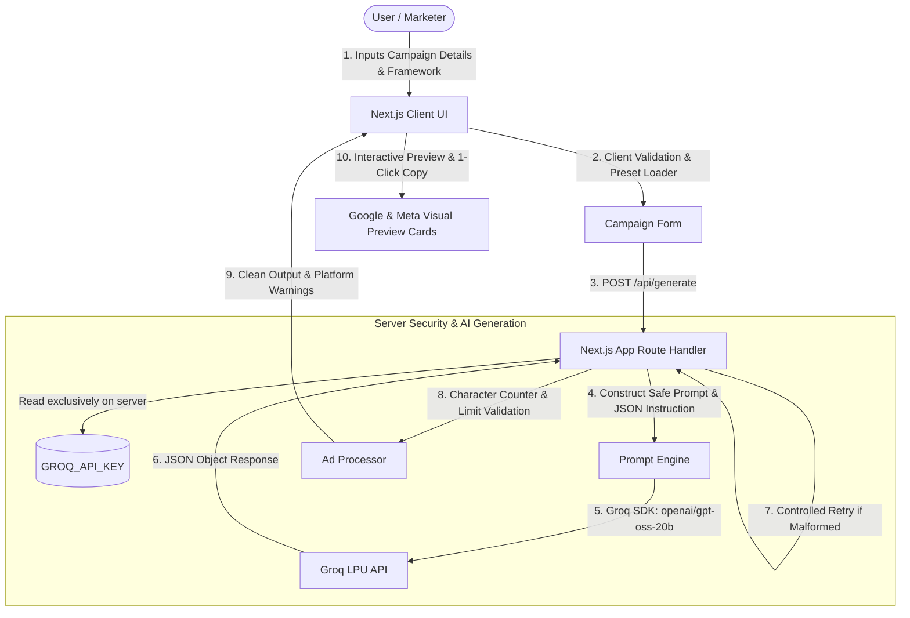

# AdNova — AI-Powered Ad Copy Variation Generator

> **“Turn ideas into ad-ready copy.”**

AdNova is a full-stack college microproject that generates structured, platform-compliant marketing ad copy variations for **Google Ads (Search)** and **Meta Ads (Facebook & Instagram Feed)** using Groq's high-speed LPU inference API and two classical copywriting frameworks:
- **AIDA:** Attention, Interest, Desire, Action
- **PAS:** Problem, Agitate, Solution

The project demonstrates practical prompt engineering, structured JSON generation, platform length constraints, client-side validation, server-side security, and error handling with Groq's free tier.

---

## 1. System Architecture



---

## 2. Key Features

- **Three-Page SaaS Architecture:**
  - **Homepage (`/`):** High-converting landing page with hero, interactive sample gallery across 5 categories (Skincare, Coffee, Food, Beverage, Fitness), feature breakdown, and 3-step workflow.
  - **Campaign Studio (`/create`):** Comprehensive 9-field campaign form with 1-click sample presets, real-time input validation, and live generation progress indicator.
  - **Results Gallery (`/results`):** Side-by-side variations with interactive favorite comparison toggles, copy actions, and persistent session state that survives page refreshes.
- **Visual Ad Posters & Multi-Format Exports:**
  - High-resolution editorial advertisement poster rendering with dynamic product photography and typography.
  - 1-click high-res PNG download, client-side A4 PDF export via `jspdf`, and direct Print mode.
- **Framework-Driven Generation:**
  - **AIDA:** Captures Attention with a high-converting hook, builds Interest with features, stimulates Desire with transformation, and calls to Action.
  - **PAS:** Identifies the target audience's Problem, Agitates the pain/consequence of inaction, and positions the product as the Solution.
- **Platform-Specific Formats & Constraints:**
  - **Google Ads:** Generates Headline 1, Headline 2, Headline 3 (flagged if exceeding 30 characters), Description 1 & 2 (flagged if exceeding 90 characters), and custom display path slugs.
  - **Meta Ads (Facebook/Instagram):** Generates Primary Text (with 125-char truncation advisory), punchy Headlines (<= 40 chars), Link Descriptions (<= 30 chars), and Call-To-Action buttons.
- **Visual Mockup Simulation:**
  - Realistic Google Search ad snippet preview.
  - Realistic Meta social feed preview card.
- **Character Count & Limit Verification:**
  - Dynamic character count badges for every copy field.
  - Clear amber warning banners if any generated field exceeds platform limits.
- **1-Click Copy Actions:**
  - Copy individual headlines, descriptions, or primary text.
  - "Copy Entire Variation" and "Copy All Variations" formatted for pasting into campaign sheets.
- **1-Click Sample Presets:**
  - Pre-loaded campaigns for B2B SaaS (*SwiftFlow*), E-Commerce (*EcoBreeze Thermostat*), and Health/Food (*Zenith Bars*) to test immediately without typing.
- **Secure Server-Side Backend:**
  - `GROQ_API_KEY` is loaded strictly on the server and never exposed to the client.
  - Prompt-injection defense: user campaign details are sanitized as raw data fields, preventing system override.
  - Controlled retry mechanism: handles transient API or parsing anomalies.
  - Safe error responses: no secret keys or internal stack traces are ever leaked to the UI.

---

## 3. Technologies Used

- **Framework:** Next.js 16 (App Router)
- **Language:** TypeScript 5
- **Styling:** Tailwind CSS 4 with custom dark marketing aesthetic
- **Icons:** Lucide React
- **AI SDK:** Official Groq TypeScript SDK (`groq-sdk`)
- **Models:** Groq Cloud (`openai/gpt-oss-20b` as primary, `openai/gpt-oss-120b` as fallback)
- **Testing:** Automated validation & prompt test suite (`scripts/test-runner.mjs`)

---

## 4. Prompt Engineering Approach

1. **System Directives:**
   - Grounded Truth: Explicitly forbids inventing fabricated prices, false discounts, fake testimonials, unverified statistics, or nonexistent features.
   - Framework Enforcement: Mandates distinct sequential stages (`attention`, `interest`, `desire`, `action` or `problem`, `agitate`, `solution`).
   - Anti-Duplication: Instructs the model to generate structurally unique angles (e.g. Pain-Point Angle, Direct Benefit Hook, Story Hook) instead of simple synonym swapping.
2. **Platform Character Constraints:**
   - Prompt provides explicit length bounds matching official Google Search and Meta Ads Feed specs.
3. **Structured JSON Mode:**
   - Leverages Groq's native `response_format: { type: 'json_object' }`.
   - Robust server-side cleanup strips markdown wrappers (` ```json `) and extracts JSON safely.

---

## 5. Getting Started

### Prerequisites
- Node.js 18+ (tested on Node v22)
- npm 9+

### Setup Instructions

1. **Clone or navigate to the project directory:**
   ```bash
   cd AdNova
   ```

2. **Install dependencies:**
   ```bash
   npm install
   ```

3. **Configure Environment Variables:**
   - Copy the sample environment file:
     ```bash
     cp .env.example .env.local
     ```
   - Open `.env.local` and add your free Groq API key:
     ```env
     GROQ_API_KEY=your_actual_groq_api_key_here
     ```
   > You can generate a free Groq API key instantly from [Groq Console](https://console.groq.com/keys).

4. **Run the development server:**
   ```bash
   npm run dev
   ```
   Open [http://localhost:3000](http://localhost:3000) in your browser.

5. **Build for production:**
   ```bash
   npm run build
   npm run start
   ```

---

## 6. Running Tests

AdNova includes an automated test suite verifying prompt construction, JSON parsing safety, character limit verifications, and payload validation:

```bash
npm test
```

### Tests Covered:
- Prompt builder generation for Google Search + PAS.
- Prompt builder generation for Meta Ads + AIDA.
- Injection defense & JSON parser resilience against raw markdown blocks.
- Google Ads character limit enforcement (30-char headline, 90-char description).
- Meta Ads character limit checks (125-char primary text recommendation).
- Server-side payload validation for required parameters.
- Missing Groq API key security handling (HTTP 401 response without stack trace leakage).
- Sanitized Groq error info extraction (HTTP 401, 429, 404).

---

## 7. Limitations & Future Scope

### Limitations
- **No Direct Ad Deployment:** AdNova generates marketing copy; it does not connect directly to the Google Ads API or Meta Marketing API to publish live ads or charge ad spend.
- **Copy Generator, Not Performance Proof:** The app structures copy using copywriting best practices; actual conversion rates depend on ad creative assets, targeting, and bidding strategy.

### Future Scope
- Exporting directly to CSV/XLSX formatted for Google Ads Editor and Meta Ads Manager bulk upload.
- Adding additional copywriting formulas (e.g., BAB: Before-After-Bridge, QUEST).
- Multi-language ad copy generation for international campaigns.

---

## 8. License & Academic Attribution
Developed as an educational college microproject demonstrating generative AI prompt engineering and full-stack web application development.
